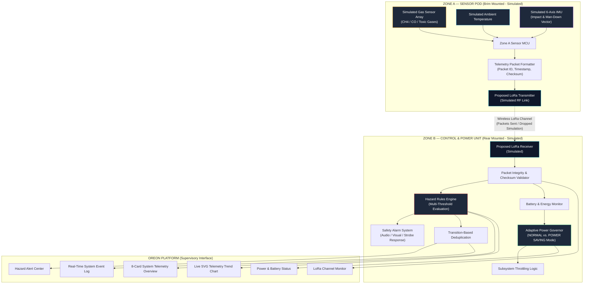

# OREON: Intelligent Mining Safety & Environmental Monitoring Platform

### Intelligence Beneath the Surface.
*Dual-Zone Hardware Architecture & Adaptive Power Management (Software Simulation Prototype)*

[](https://www.typescriptlang.org/)
[](https://react.dev/)
[](https://vitejs.dev/)
[](https://tailwindcss.com/)
[](https://opensource.org/licenses/MIT)

---

## 📌 Project & Team Information

- **Product Name:** OREON
- **Brand Tagline:** Intelligence Beneath the Surface.
- **Product Category:** Intelligent Mining Safety & Environmental Monitoring Platform
- **Team Name:** VAYUJ NEXUS
- **Team ID:** HSN|TN|00803
- **State:** Tamil Nadu
- **System Classification:** Prototype Software Simulation (Concept Demonstrator)

> [!WARNING]
> **IMPORTANT REALITY CONSTRAINT & DISCLAIMER**
>
> This application is a **SOFTWARE SIMULATION** of the proposed OREON system.
> - **NO PHYSICAL SENSORS OR LORA TRANSCEIVERS ARE CONNECTED.**
> - All telemetry readings (hazardous gas ppm, ambient temperature, IMU fall/impact), packet transmission counters, battery percentages, and RF communication link states are generated by deterministic frontend algorithms for architecture validation and concept demonstration.
> - This software does **NOT** claim real-world mining safety certification (e.g., DGMS / ATEX / IECEx) or validated hardware performance. Physical hardware integration and empirical underground testing are scheduled for future development phases.

---

## 🚨 Problem Statement

Underground mining environments present severe occupational hazards to personnel:
1. **Atmospheric Hazards:** Rapid build-up of toxic and combustible gases (such as methane, carbon monoxide, and hydrogen sulfide) without immediate worker detection.
2. **Thermal Stress:** Dangerous elevation of subterranean ambient temperatures leading to heat stroke and exhaustion.
3. **Physical Trauma:** Worker falls, roof collapses, and severe mechanical impacts that cause immediate incapacitation (man-down events).
4. **Communication & Power Constraints:** Traditional wearable safety devices suffer from high power draw, short battery life, single-point microcontroller failures, and poor wireless signal propagation in deep mine galleries.

---

## 💡 Proposed Solution

**OREON** introduces a modular, fault-tolerant **Dual-Zone Hardware Architecture** coupled with **Adaptive Power Management** designed specifically for mining safety helmets:

1. **Dual-Zone Decoupling:** Isolates sensitive sensor acquisition (Zone A) from power distribution and safety computation (Zone B), preventing single-point hardware lockups.
2. **Low-Power Inter-Zone RF (LoRa):** Proposes a lightweight wireless telemetry link between the helmet brim sensor unit and the rear control unit.
3. **Automated Hazard Detection:** Real-time multi-hazard classification with operator acknowledgment and persistent event logging.
4. **Adaptive Power Management:** Dynamically throttles sampling rates and radio transmissions when battery reserves drop below demo thresholds.

---

## 🏗️ System Architecture



### Unit Responsibilities

#### Zone A — Sensor Unit
- **Simulated Environmental Acquisition:** Samples simulated gas concentration (ppm) and ambient temperature (°C).
- **Simulated IMU Orientation:** Evaluates 6-axis acceleration vectors for impact and fall (man-down) conditions.
- **Packet Generation:** Constructs sequence-numbered telemetry packets with checksum validation.
- **Simulated Transmission:** Transmits packets through the proposed LoRa wireless channel.

#### Zone B — Control & Power Management Unit
- **Packet Reception & Validation:** Simulates LoRa reception, validates packet checksums, and flags communication timeouts.
- **Hazard Analysis:** Evaluates readings against configurable safety thresholds (Gas, Temperature, Fall).
- **Automated Response Triggering:** Commands audio/visual safety actions (e.g. helmet strobe, man-down beacon).
- **Adaptive Power Management:** Monitors battery percentage; switches from `NORMAL` mode to `POWER SAVING` mode when capacity drops below the demo threshold (20%), throttling non-critical tasks.

---

## 📡 Simulated LoRa Data Packet Structure

The prototype implements a clean, human-readable JSON packet format:

```json
{
  "packetId": 108,
  "timestamp": "20:15:32",
  "gasLevel": 18.2,
  "temperature": 24.6,
  "fallDetected": false,
  "sourceZone": "ZONE_A_SENSOR",
  "destinationZone": "ZONE_B_CONTROL",
  "checksumValid": true
}
```

### Field Definitions:
- `packetId`: Auto-incrementing packet sequence counter.
- `timestamp`: Time of packet generation (`HH:mm:ss`).
- `gasLevel`: Simulated hazardous gas concentration in parts per million (ppm).
- `temperature`: Simulated ambient helmet temperature in degrees Celsius (°C).
- `fallDetected`: Boolean flag indicating IMU impact vector / sudden loss of orientation.
- `sourceZone`: Fixed origin identifier (`ZONE_A_SENSOR`).
- `destinationZone`: Fixed target identifier (`ZONE_B_CONTROL`).
- `checksumValid`: Integrity verification flag validated by Zone B.

---

## ⚡ Simulated Adaptive Power Management

| Battery Level | Power Mode | Simulated Behavior | System Response |
| :--- | :--- | :--- | :--- |
| **> 20%** | `NORMAL` | Full sensor sampling (1.5s interval), nominal radio polling, all peripherals active. | "Nominal baseline monitoring. Dual-zone LoRa link verified." |
| **≤ 20%** | `POWER SAVING` | Throttled background tasks, reduced battery drain rate (0.02%/tick vs 0.06%/tick), visual alerts prioritized over non-critical telemetry. | "ADAPTIVE POWER SAVING ACTIVE: Non-essential peripherals throttled to extend operating life." |

---

## 🎯 Configurable Demo Thresholds

The dashboard provides a dedicated **Thresholds** configuration modal:

- **Hazardous Gas Warning:** `35 ppm` (Configurable range: 5–150 ppm)
- **Hazardous Gas Critical:** `75 ppm` (Configurable range: 10–300 ppm)
- **Ambient Temp Warning:** `38.0 °C` (Configurable range: 20–60 °C)
- **Ambient Temp Critical:** `45.0 °C` (Configurable range: 25–80 °C)
- **Zone B Low Battery:** `20 %` (Configurable range: 5–50 %)

> *Note: These are illustrative demonstration thresholds for evaluating the software state engine, not statutory occupational limits.*

---

## 🎮 Interactive Demo Scenarios

The dashboard features 9 one-click demo scenarios to trigger and test all proposed system responses:

1. **NORMAL OPERATION:** Restores baseline telemetry (~18 ppm gas, ~24.6°C temp), reconnects LoRa link, clears fall flags, and sets battery to 92%.
2. **GAS WARNING:** Forces simulated gas concentration to `48 ppm` (>35 ppm threshold), generating a warning alert and logging the event.
3. **CRITICAL GAS ALERT:** Spikes simulated gas to `92 ppm` (>75 ppm threshold), transitioning the system status to `CRITICAL` and activating emergency evacuation protocols.
4. **HIGH TEMPERATURE:** Elevates simulated ambient temperature to `43.5 °C` (>38°C threshold), triggering thermal warnings.
5. **FALL / IMPACT DETECTED:** Injects an IMU 6-axis shock event, setting `fallDetected: true` and triggering an immediate man-down critical alarm.
6. **LoRa Communication Failure:** Simulates wireless link severance between Zone A and Zone B. Halts packet reception, logs packet loss events, and sets Zone B status to `TIMEOUT`.
7. **RESTORE COMMUNICATION:** Re-establishes the simulated LoRa channel, resuming successful packet receipt and checksum validation.
8. **LOW BATTERY:** Sets Zone B battery to `14.0%` (<20% threshold), triggering a low-battery alert and automatically activating **ADAPTIVE POWER SAVING** mode.
9. **RESET SIMULATION:** Clears all test overrides, resets packet counters, and restores the simulation engine to initial defaults cleanly without timer leaks.

---

## 🧭 Application Information Architecture & Pages

The application is structured around a persistent, collapsible enterprise sidebar inspired by Ciklum:

1. **Overview:** Executive KPI dashboard with sparklines, primary area charts, system health diagram, recent alerts, and events.
2. **Zone A — Sensor Unit:** Dedicated sensor pod interface with real-time gas, temperature, and 6-axis IMU shock vector waveforms, processing pipeline, and packet JSON inspector.
3. **Zone B — Control & Power:** Supervisory control unit with packet reception counters, checksum verification, adaptive energy policy, and recent packet inspector.
4. **LoRa Communication:** Proposed wireless link monitoring, animated RF carrier channel, packet delivery rate charts, and paginated transmission history.
5. **Analytics (High Visual Priority):** Multi-metric waveform suite featuring 7 synchronized charts:
   - Hazardous Gas Concentration with warning & critical threshold lines.
   - Subterranean Ambient Temperature with thermal limit lines.
   - Simulated Battery Discharge curve with power-save transition line.
   - LoRa Packet Delivery Performance & loss outages.
   - Dual-Axis Sensor Correlation (Gas vs Temperature).
   - IMU 6-Axis Kinetic Acceleration Shock Vector (g).
   - System Status State Machine Step Transition Timeline.
6. **Alerts:** Deduplicated active and historical safety alarms with severity filters, search, and supervisor acknowledgment.
7. **Event Logs:** Comprehensive audit log with category filters, level filters, and one-click CSV / JSON export.
8. **Settings:** Configurable demo thresholds, simulation update interval slider, deterministic mode, and project architecture metadata.

---

## 💻 Technology Stack

- **Framework:** [React 18.3](https://react.dev/)
- **Build Tool:** [Vite 6.0](https://vitejs.dev/)
- **Language:** [TypeScript 5.6](https://www.typescriptlang.org/)
- **Styling:** [Tailwind CSS 3.4](https://tailwindcss.com/) with enterprise industrial-tech palette (`#F7F8FA`, `#FFFFFF`, `#171A21`, `#697386`, refined copper brand accent `#C47A35`, and strict safety status tokens)
- **Data Visualization:** [Recharts 2.15](https://recharts.org/) (high-fidelity multi-metric time-series area charts, step charts, and dual-axis correlation)
- **Icons:** [Lucide React](https://lucide.dev/)
- **Architecture:** Client-side local deterministic simulation engine (zero external cloud dependencies, 100% offline-ready)

---

## 🛠️ Prerequisites & Installation (Windows)

### Prerequisites:
- [Node.js](https://nodejs.org/) v18.0.0 or higher (v22+ tested)
- npm v9+

### Installation Steps on Windows:

1. Open **Command Prompt (`cmd`)** or **PowerShell** in the project directory:
   ```cmd
   cd c:\MineGuard
   ```

2. Install dependencies:
   ```cmd
   npm install
   ```
   *(Note: If PowerShell complains about script execution policies, run `cmd /c "npm install"` or `npm.cmd install`)*

3. Start the local development server:
   ```cmd
   npm run dev
   ```

4. Open your browser to the local URL:
   ```
   http://localhost:5173/
   ```

5. To create an optimized production build:
   ```cmd
   npm run build
   ```

---

## 🧪 Testing and Validation

All features have been systematically tested using browser automation:

| Test Item | Verification Criteria | Status |
| :--- | :--- | :--- |
| **Ciklum-Inspired Enterprise UI** | Clean light palette (`#F7F8FA`), refined cards, crisp typography, coral accents | **PASSED** |
| **Persistent Left Sidebar** | 8 navigation items, active indicator bar, mobile drawer, collapse toggle | **PASSED** |
| **Overview Dashboard** | KPI summary with sparklines, primary charts, system health flow, recent alerts | **PASSED** |
| **Dedicated Zone A & B Pages** | Independent views for Sensor Pod and Control Unit with packet inspectors | **PASSED** |
| **Proposed LoRa Link Page** | Packet delivery charts, animated carrier channel, paginated packet table | **PASSED** |
| **Analytics Suite (7 Charts)** | Gas, Temp, Battery, Delivery, Correlation, IMU, and Status History step chart | **PASSED** |
| **Start / Pause Controls** | Simulation timer pauses and resumes cleanly without stale closures | **PASSED** |
| **Interactive Scenarios** | Gas Warning, Critical Gas, Fall/Impact, LoRa Failure, Restore, Low Battery | **PASSED** |
| **Alert Acknowledgment** | Operator acknowledgment transitions alerts to ACKNOWLEDGED; updates badge | **PASSED** |
| **State Persistence Across Tabs** | Navigating between sidebar tabs never resets or disrupts the simulation | **PASSED** |
| **Event Log Export** | Filterable audit entries with working CSV and JSON export | **PASSED** |
| **Settings Configuration** | Threshold validation, sample interval slider (800ms–3500ms), reset all | **PASSED** |
| **Console Errors** | Browser console inspected during all interactions with **0 errors** | **PASSED** |

---

## ⚠️ Project Limitations & Reality Constraints

1. **Software Simulation Only:** No physical microcontroller, sensor board, or LoRa module is interfaced to this computer.
2. **Simulated Telemetry:** Gas levels, temperatures, and IMU shocks are synthetically generated.
3. **Conceptual Radio Link:** LoRa packet counts and drop rates are simulated in software. Specific frequency bands (e.g., 868 MHz / 433 MHz / 915 MHz), SF (Spreading Factor), CR (Coding Rate), and physical RSSI/SNR values remain to be characterized in physical tunnels.
4. **Safety Disclaimers:** This prototype is strictly for technological demonstration and academic evaluation. It must not be deployed in real hazardous underground operations without physical hardware fabrication, intrinsic safety barriers (IS), and formal regulatory testing.

---

## 🔮 Future Hardware Integration Plan

1. **Zone A Physical Prototyping:**
   - Design of custom brim-mounted PCB incorporating electrochemical gas sensors (MQ/Sensirion), optical particulate sensors, and an ultra-low-power 6-axis IMU (e.g., MPU6050 / LSM6DSOX).
   - Microcontroller firmware development (ARM Cortex-M0+ or ESP32-C3).
2. **Zone B Physical Prototyping:**
   - Helmet rear-chassis integration with integrated Li-Ion battery, BMS protection circuit, and SX1262 LoRa transceiver.
   - Dedicated audio buzzer and multi-color 360° LED strobe alert ring.
3. **Underground RF Validation:**
   - Field propagation testing in subterranean stone/coal galleries to calibrate LoRa link budgets and antenna design.
4. **Regulatory Certification:**
   - Formal intrinsic safety compliance testing (DGMS / ATEX Zone 0/1 certification).

---

## 📄 License

This software simulation prototype is open-sourced under the [MIT License](LICENSE).

*Disclaimer: The MIT license applies solely to the software source code in this repository and does not grant or imply mining occupational safety certifications or physical equipment compliance.*
